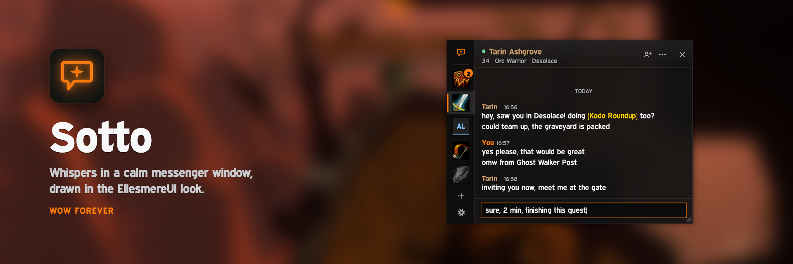

# Sotto



**Whispers in a calm messenger window, drawn in the EllesmereUI look.**
A whisper messenger for World of Warcraft: Forever, in the spirit of WIM, with only the
options that matter.

## What it does

- **One window for every whisper.** Character whispers and Battle.net whispers, incoming
  and outgoing. A slim rail on the left holds one badge per conversation: class icon,
  unread count, offline contacts greyed out.
- **Reads like a messenger.** Name and time once per run of messages, day separators, a
  "New" line above what you have not read yet, clickable items, quests and links
  (links open a copy box).
- **Answer where you read.** Enter sends, long messages are split for you, Up and Down
  bring back what you sent, every conversation keeps its own draft, shift-clicked items
  land in the box.
- **Stays out of your way.** Out of combat the window opens on a new whisper; in combat a
  small card slides in instead (or always, if you prefer). No keyboard focus is taken
  unless you ask for it. The window fades while you are not using it.
- **Your whispers, your window.** Your reply key opens Sotto, and a whisper you start from
  the chat box or a player menu continues there. Whispers are hidden from the normal chat
  window. (Inside dungeons and raids the game hides whispers from addons, so there your
  reply key stays with the normal chat.)
- **Remembers.** Conversations survive reloads and logouts (7, 30 or 90 days, or until
  logout).
- **Matches your UI.** With EllesmereUI it follows your panel colour, font and accent live;
  the accent can also be your class colour. Without EllesmereUI it uses the same palette
  and the game font.

## Boss fights and other lockdowns

Since the 12.x engine the game hides whisper contents from addons during boss
encounters, Mythic+ and rated PvP (and on some restricted maps). Sotto shows a notice
then: those whispers stay in your normal chat and land in Sotto when the lockdown ends.
Sending from Sotto pauses during that time; your draft waits.

## Commands and key bindings

| | |
|---|---|
| `/sotto` | open or close the window |
| `/sotto settings` | open the settings |
| `/sotto reset` | put the window back where it started |

Key bindings (Options > Key Bindings > AddOns > Sotto): **Show or hide Sotto**, **Reply to
the last whisper**, **Whisper the last person you whispered**, **Next unread
conversation**. With "Use Sotto for replies" on, your normal reply keys do the same. The
minimap button and the addon compartment open it too.

## Settings

Open the window when a whisper arrives (always, out of combat, never) · sound (soft chime,
the game's whisper sound, none) · hide whispers from the chat window · use Sotto for
replies · accent (class colour or EllesmereUI) · text size · fade when idle · remember
conversations · minimap button.

## Coming from WIM?

Sotto notices WIM and offers to turn it off (it disables WIM and EllesmereSkin_WIM and asks
for a reload), so whispers do not arrive twice.

## Development

The addon is plain Lua with no libraries. An offline suite runs it inside a fake WoW
Forever client:

```sh
luajit tests/run.lua && luajit tests/syntax.lua
python3 -I tests/test_media.py   # needs Pillow
```

Media is generated: `python3 -I tools/make_media.py .` and `python3 -I tools/make_sound.py .`
(needs Pillow and ffmpeg). Releases: see [docs/RELEASING.md](docs/RELEASING.md).

## License

MIT © creazy231
